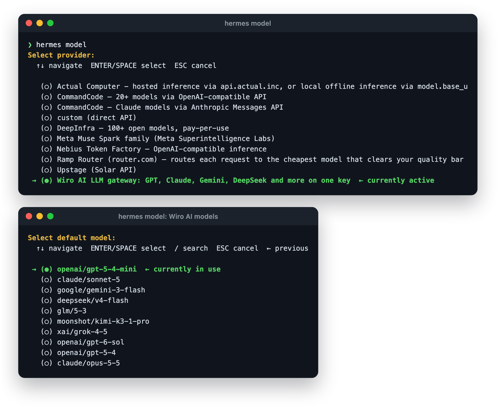
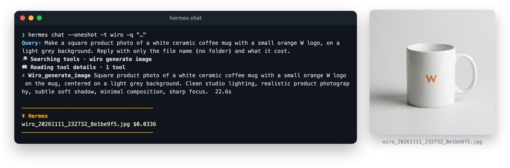
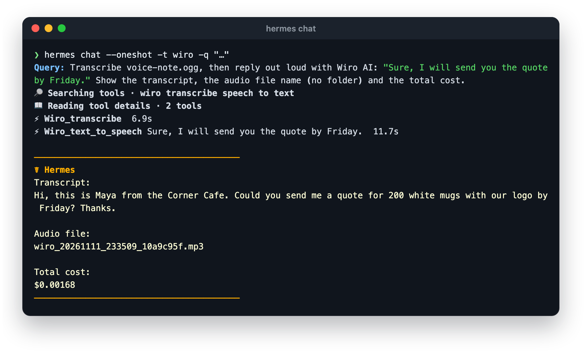

# Wiro-Hermes

[Wiro AI](https://wiro.ai) for [Hermes Agent](https://github.com/NousResearch/hermes-agent): image,
video, speech, music, transcription and 3D tools with 1,000+ models, and the Wiro AI LLM gateway as
a model provider, all on one API key.

| Plugin | What it adds |
| --- | --- |
| [`wiro-media`](wiro-media/) | Thirteen `wiro_*` tools: generate and edit images, make video from a prompt or a picture, read text aloud, compose music, transcribe audio, build 3D models, search the catalog with prices, and run any model or workflow. Wiro AI as the backend of Hermes' own `image_generate`, `video_generate`, `text_to_speech` and voice message transcription. A skill with recipes. |
| [`wiro`](wiro/) | The Wiro AI LLM gateway as a model provider: GPT, Claude, Gemini, DeepSeek, GLM, Kimi and Grok models on one OpenAI-compatible API. |

```sh
hermes plugins install wiro-media --enable   # tools and media backends
hermes plugins install wiro                  # chat models, then pick Wiro AI in `hermes model`
hermes config set WIRO_API_KEY <your-key>
```

Until the `wiro-media` catalog listing lands, install it from the repository:
`hermes plugins install "https://github.com/wiroai/Wiro-Hermes#wiro-media" --enable`.

Create a key at [wiro.ai/panel/project](https://wiro.ai/panel/project). Each plugin's README
covers setup, models and settings: [`wiro-media`](wiro-media/README.md), [`wiro`](wiro/README.md).
Hermes loads model providers and tool plugins through separate paths, so they are two plugins;
install one or both. Runs are paid as you go from your Wiro AI wallet. API docs:
[wiro.ai/docs](https://wiro.ai/docs).

With `wiro` installed, `hermes model` lists Wiro AI with the other providers. Pick it, then pick
a model:



## In use

Ask in plain words. Hermes finds the right `wiro_*` tool, runs a Wiro AI model, saves the file
and says what the run cost:



Voice notes work the same way: Hermes writes out what was said and answers out loud with a Wiro
AI voice:



## Development

Tests run against a Hermes source checkout (`HERMES_SOURCE`, a sibling `hermes-agent`
directory, or `PYTHONPATH`):

```sh
python -m pytest tests -q
hermes plugins validate wiro --install-deps
hermes plugins validate wiro-media --install-deps
```

The media tests run the plugin inside Hermes against an in-memory Wiro AI API, so they need no
key; with `ffmpeg` installed they also cover the voice note conversion. With `WIRO_API_KEY` set,
`WIRO_LIVE_CATALOG=1 python -m pytest tests -q` also compares the model provider's table against
the live catalog.

MIT license.

## More from Wiro AI

| Repository | What it is |
| --- | --- |
| [Wiro-MCP](https://github.com/wiroai/Wiro-MCP) | Official MCP server for Wiro AI, [`@wiro-ai/wiro-mcp` on npm](https://www.npmjs.com/package/@wiro-ai/wiro-mcp) |
| [Wiro-Plugin](https://github.com/wiroai/Wiro-Plugin) | Wiro AI plugin for Cursor, Claude Code, Gemini CLI, Devin, Antigravity and Kiro |
| [Wiro-Skills](https://github.com/wiroai/Wiro-Skills) | Agent skills for images, image edits, video, music, speech, transcripts, 3D and model search |
| [Wiro-LLM](https://github.com/wiroai/Wiro-LLM) | Vercel AI SDK provider for chat, images, speech, transcription and video, [`@wiro-ai/wiro-llm` on npm](https://www.npmjs.com/package/@wiro-ai/wiro-llm) |
| [Wiro-Chromium-Extension](https://github.com/wiroai/Wiro-Chromium-Extension) | Wiro AI extension for Chrome, Edge, Opera and Brave |
| [Wiro-Firefox-Extension](https://github.com/wiroai/Wiro-Firefox-Extension) | Wiro AI add-on for Firefox |
| [Wiro-Safari-Extension](https://github.com/wiroai/Wiro-Safari-Extension) | Wiro AI extension for Safari on the Mac |
| [Swift-QuickStart](https://github.com/wiroai/Swift-QuickStart) | WiroKit, the Wiro AI SDK for iOS |
| [Kotlin-QuickStart](https://github.com/wiroai/Kotlin-QuickStart) | WiroKit, the Wiro AI SDK for Android |
| [Dart-QuickStart](https://github.com/wiroai/Dart-QuickStart) | Wiro AI SDK for Dart and Flutter, [`wiro` on pub.dev](https://pub.dev/packages/wiro) |
| [ReactNative-QuickStart](https://github.com/wiroai/ReactNative-QuickStart) | Wiro AI SDK for React Native and Expo, [`@wiro-ai/wiro-react-native` on npm](https://www.npmjs.com/package/@wiro-ai/wiro-react-native) |
| [Swift-Realtime](https://github.com/wiroai/Swift-Realtime) | Realtime voice AI example for iOS |
| [Kotlin-Realtime](https://github.com/wiroai/Kotlin-Realtime) | Realtime voice AI example for Android |
| [Dart-Realtime](https://github.com/wiroai/Dart-Realtime) | Realtime voice AI example for Flutter |
| [ReactNative-Realtime](https://github.com/wiroai/ReactNative-Realtime) | Realtime voice AI example for React Native |
| [n8n-nodes-wiroai](https://github.com/wiroai/n8n-nodes-wiroai) | Wiro AI nodes for n8n, [`@wiro-ai/n8n-nodes-wiroai` on npm](https://www.npmjs.com/package/@wiro-ai/n8n-nodes-wiroai) |
| [Wiro-Dify-Plugin](https://github.com/wiroai/Wiro-Dify-Plugin) | Wiro AI plugins for Dify: the LLM gateway as a model provider, plus image, video, speech and music tools |
| [Wiro-ComfyUI](https://github.com/wiroai/Wiro-ComfyUI) | Wiro AI nodes for ComfyUI |
| [Wiro-Zed](https://github.com/wiroai/Wiro-Zed) | Wiro AI MCP server extension for Zed |
| [Wiro-Action](https://github.com/wiroai/Wiro-Action) | GitHub Action for Wiro AI models and the LLM gateway, [on the GitHub Marketplace](https://github.com/marketplace/actions/wiro-ai-action) |
| [Wiro-Raycast](https://github.com/wiroai/Wiro-Raycast) | Wiro AI extension for Raycast: image and video generation, LLM chat and model search |
| [Wiro-WordPress](https://github.com/wiroai/Wiro-WordPress) | Wiro AI plugin for WordPress: featured images, image edits, alt text, narration and SEO suggestions |
| [Wiro-Obsidian](https://github.com/wiroai/Wiro-Obsidian) | Wiro AI plugin for Obsidian: images, video, speech, music, transcription and text tools |
| [Wiro-Blender](https://github.com/wiroai/Wiro-Blender) | Wiro AI add-on for Blender: text to 3D, image to 3D and textures |
| [Wiro-Figma](https://github.com/wiroai/Wiro-Figma) | Wiro AI plugin for Figma: images, vectors, image edits and text |
| [Wiro-Next-Starter](https://github.com/wiroai/Wiro-Next-Starter) | Next.js starter for Wiro AI: Playground, image, video and audio tools, and LLM chat, ready for Vercel and Railway |
| [Wiro-Docs](https://github.com/wiroai/Wiro-Docs) | Source of the Wiro AI API docs |

[Website](https://wiro.ai) · [Models](https://wiro.ai/models) · [Docs](https://wiro.ai/docs) · [X](https://x.com/wiroai)
